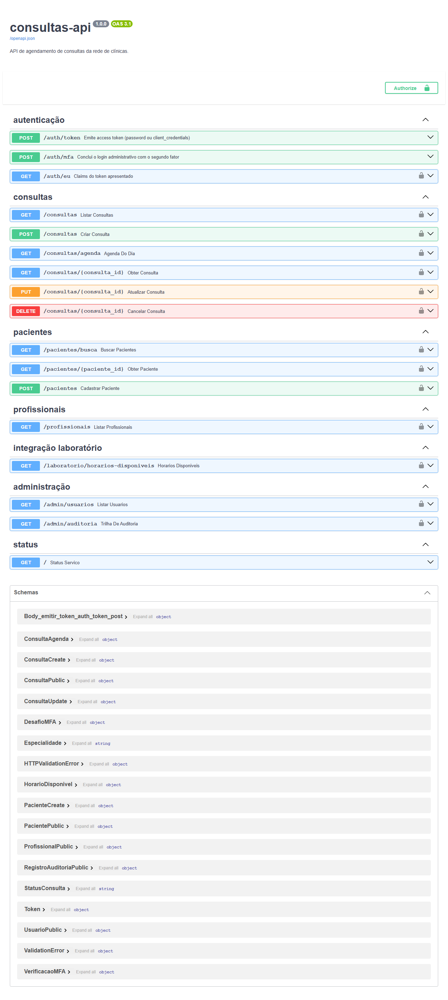

# Exercício 1 - Fundação da API de agendamento

## Ambiente isolado

O projeto roda em um ambiente virtual próprio, criado na raiz do serviço:

```
python -m venv venv
venv\Scripts\activate
pip install -r requirements.txt          # dependências da aplicação
pip install -r requirements-dev.txt      # + pytest, bandit, pip-audit
```

As versões estão fixadas em `requirements.txt`. Fixar versão é um controle de segurança e não só de reprodutibilidade: o pip-audit do Exercício 12 audita exatamente o que vai para produção, e uma atualização silenciosa de dependência não entra sem passar pelo pipeline. A evidência (`evidencias/ex01-fundacao.txt`) mostra `sys.prefix` diferente de `sys.base_prefix`, ou seja, o interpretador em uso é o do venv, e o `pip freeze` do ambiente.

## Estrutura modular

```
main.py                 cria o app, registra middlewares e routers
app/
  config.py             configuração e segredos (BaseSettings)
  models.py             contratos de entrada e saída (Pydantic)
  db_models.py          tabelas (SQLModel)
  database.py           engine, sessão e consultas parametrizadas
  validators.py         regex e whitelists de entrada
  limiter.py            rate limiting
  middlewares.py        autenticação JWT, guarda de posse, cabeçalhos
  seed.py               dados de avaliação (desligado por padrão)
  auth/                 camada de autenticação separada
    security.py         bcrypt, JWT, MFA, bloqueio por identidade
    permissoes.py       matriz RBAC e audiências
    autenticacao.py     fluxos password e client_credentials
    dependencies.py     principal, escopos, fábrica de posse, auditoria
    csrf.py             token anti-CSRF da página da recepção
  routes/               um APIRouter por recurso
    consultas.py  pacientes.py  profissionais.py  laboratorio.py
    admin.py  auth.py  web.py  inseguro.py
templates/  static/  tests/  ci/  docs/  evidencias/
```

A dependência entre módulos é de mão única: `routes` importa `auth`, `database`, `models` e `validators`; `database` importa `db_models` e `config`; `models` só importa `validators`. Nenhuma regra de segurança aparece em mais de um lugar: decodificar JWT existe só em `AutenticacaoJWTMiddleware`, verificar posse só em `exigir_posse`, gravar auditoria só em `auditar`.

## Recurso RESTful de consultas

`app/routes/consultas.py` expõe o recurso completo em um `APIRouter` com prefixo `/consultas`:

| Método | Rota | Operação |
|---|---|---|
| GET | `/consultas` | Lista as consultas visíveis ao chamador |
| GET | `/consultas/agenda` | Agenda do dia para a recepção |
| POST | `/consultas` | Cria consulta (201) |
| GET | `/consultas/{id}` | Detalha uma consulta |
| PUT | `/consultas/{id}` | Remarca ou altera |
| DELETE | `/consultas/{id}` | Cancela (mantém o registro com status `cancelada`) |

O cancelamento é lógico: apagar fisicamente uma consulta destruiria o histórico clínico e a trilha de quem alterou o quê.

A primeira versão deste esqueleto guardava as consultas em memória dentro de `database.py`; a interface de repositório (`listar_consultas`, `obter_consulta`, `criar_consulta`...) foi desenhada já nesse formato para que a migração do Exercício 11 trocasse só a implementação, sem mexer nas rotas.

## Primeiro teste automatizado

`tests/test_consultas.py` é o arquivo de testes que cresce ao longo do Assessment. O caso de sucesso exigido é `test_profissional_cria_consulta_e_ela_aparece_na_listagem`: autentica a profissional, cria uma consulta, confere 201, os nomes resolvidos, e que ela aparece na listagem e no detalhe com o mesmo conteúdo. `tests/conftest.py` prepara um banco descartável em diretório temporário e recria os dados antes de cada teste, então a ordem de execução não influencia o resultado.

```
$ python -m pytest tests/test_consultas.py -v
tests/test_consultas.py::test_profissional_cria_consulta_e_ela_aparece_na_listagem PASSED
...
```



Evidências: `evidencias/ex01-fundacao.txt`, `evidencias/tela-01-swagger-rotas.png`.
