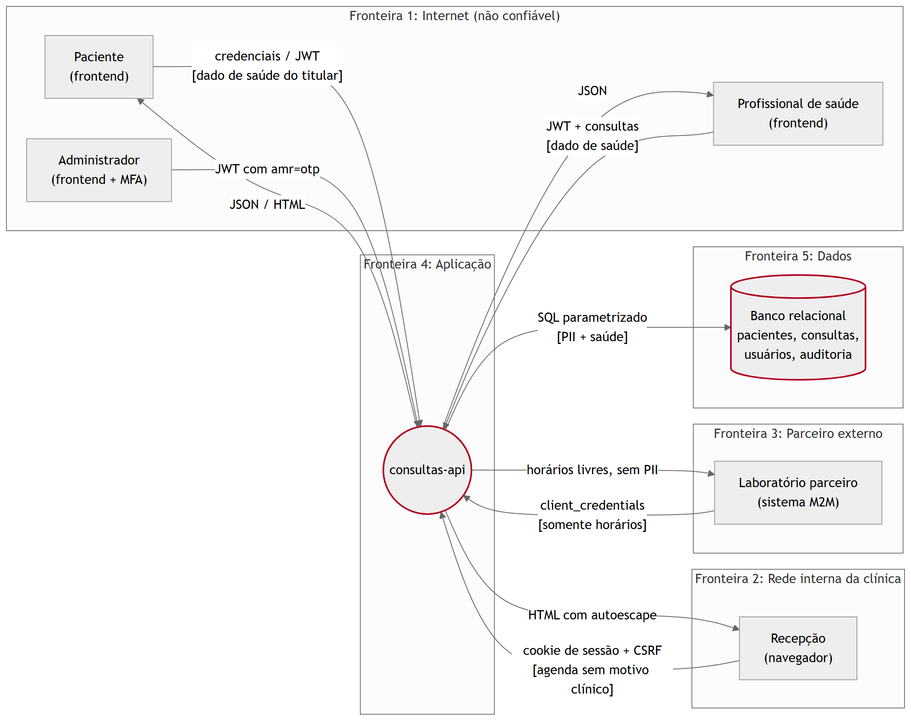
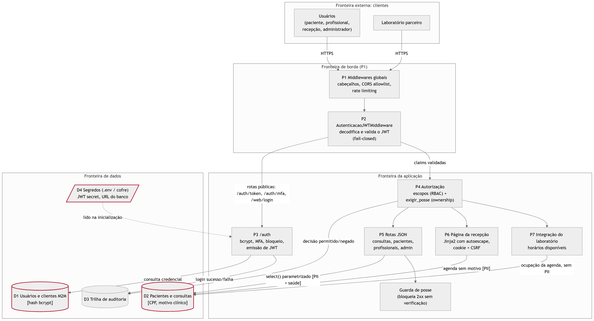

# Exercício 3 - Fundamentos de segurança e modelagem inicial

## Tríade CIA

A confidencialidade tem peso maior que as outras duas propriedades porque o sistema trata dado referente à saúde, categoria de dado pessoal sensível (LGPD, art. 5º, II). Vazamento desse dado é irreversível, exige comunicação à ANPD e ao titular (art. 48) e sujeita a empresa às sanções do art. 52. Integridade vem em seguida: uma consulta remarcada indevidamente tira o atendimento de uma pessoa. Disponibilidade importa, mas a clínica tem plano de contingência manual (agenda em papel) que não existe para um vazamento.

| Propriedade | Ativo crítico | Ameaça concreta | Controle implementado |
|---|---|---|---|
| Confidencialidade | Motivo e observações da consulta | Paciente lê consulta de outro trocando o id (BOLA) | `exigir_posse` e `GuardaAutorizacaoMiddleware` |
| Confidencialidade | CPF e contato do paciente | Resposta com campo além do necessário | `response_model`, `PacientePublic` com CPF mascarado |
| Confidencialidade | Dado clínico na recepção | Recepcionista vendo motivo de consulta | `ConsultaAgenda` sem `motivo`, escopo `agenda:ler` |
| Confidencialidade | Dado em trânsito | Interceptação | HSTS e TLS na borda (risco residual R-03) |
| Integridade | Agenda | Profissional cancela consulta de outro; mass assignment | `consulta_alteravel`, `extra="forbid"` |
| Integridade | Página da recepção | XSS armazenado alterando a página | Autoescape, CSP |
| Integridade | Token | JWT adulterado ou com `alg=none` | Algoritmo fixado, assinatura, `aud`, papel conferido no banco |
| Integridade e responsabilização | Histórico de acesso | Ninguém sabe quem leu o quê | `RegistroAuditoria` |
| Disponibilidade | API e login | Força bruta, flood | Rate limiting por tipo de rota, bloqueio por identidade |
| Disponibilidade | Banco | Consulta sem limite | Janela de 60 dias, tamanho máximo dos campos |

## Frameworks de referência mapeados a controles

| Framework | Item | Controle concreto | Onde |
|---|---|---|---|
| OWASP Top 10 2021 | A01 Broken Access Control | Escopos por papel + `exigir_posse` + guarda fail-closed | `app/auth/dependencies.py`, `app/middlewares.py` |
| OWASP Top 10 2021 | A02 Cryptographic Failures | bcrypt custo 12; JWT HS256 com segredo ≥ 32 caracteres | `app/auth/security.py`, `app/config.py` |
| OWASP Top 10 2021 | A03 Injection | `select()` parametrizado, whitelist regex, autoescape | `app/database.py`, `app/validators.py`, `templates/` |
| OWASP Top 10 2021 | A04 Insecure Design | `extra="forbid"`, contratos de saída por consumidor | `app/models.py` |
| OWASP Top 10 2021 | A05 Security Misconfiguration | Cabeçalhos, CORS allowlist, docs desligável | `app/middlewares.py`, `main.py` |
| OWASP Top 10 2021 | A07 Identification and Authentication Failures | MFA, rate limit, bloqueio, mensagem única | `app/auth/` |
| OWASP Top 10 2021 | A09 Security Logging and Monitoring Failures | Trilha de auditoria de acesso | `RegistroAuditoria` |
| OWASP API Security Top 10 2023 | API1 BOLA, API3 BOPLA, API5 BFLA | `exigir_posse`, `response_model` + `extra="forbid"`, `exigir_administrador` | idem |
| OWASP ASVS 4.0 | V2 autenticação, V3 sessão, V4 controle de acesso, V5 validação | bcrypt, cookie HttpOnly/SameSite, ownership, whitelist | idem |
| NIST SSDF (SP 800-218) | PO.1 requisitos de segurança | Requisitos do enunciado viraram threat model e testes T-xx | `docs/threat-model.md` |
| NIST SSDF | PS.1 proteger o código e segredos | `.env` fora do repositório, `SecretStr` | `app/config.py`, `.gitignore` |
| NIST SSDF | PW.1 design seguro / PW.5 codificação segura | Defesa em profundidade, validação centralizada | `app/auth/`, `app/validators.py` |
| NIST SSDF | PW.7 / PW.8 revisar e testar | pytest de segurança, Bandit, Semgrep, ZAP | `tests/`, `.github/workflows/security.yml` |
| NIST SSDF | RV.1 / RV.2 identificar e corrigir vulnerabilidades | pip-audit agendado, security gate, exceções com validade | `ci/security_gate.py` |
| MITRE ATT&CK | T1110 Brute Force | Rate limit 5/min e bloqueio por identidade | `app/limiter.py`, `app/auth/security.py` |
| MITRE ATT&CK | T1078 Valid Accounts | MFA para administrador; usuário desativado perde acesso imediato | `app/auth/` |
| MITRE ATT&CK | T1190 Exploit Public-Facing Application | Validação, parametrização, cabeçalhos | `app/validators.py`, `app/database.py` |
| MITRE ATT&CK | T1552 Unsecured Credentials | Segredo obrigatório no ambiente; Semgrep `p/secrets` | `app/config.py` |
| MITRE CWE | CWE-639, 89, 79, 915, 352, 307, 798 | Cada CWE tem teste e controle (ver Exercício 13) | `tests/` |

## DFD

Nível 0 (contexto), com as cinco fronteiras de confiança. As setas marcadas com `[dado de saúde]` e `[PII]` são os fluxos sensíveis.

Nível 1, abrindo a aplicação em processos:

| Fronteira | O que cruza | Controle na travessia |
|---|---|---|
| Internet → borda | Credenciais, JWT, dado de saúde do titular | TLS/HSTS, CORS allowlist, rate limit |
| Rede da clínica → borda | Cookie de sessão da recepção | HttpOnly, Secure, SameSite=Strict, CSRF |
| Parceiro → borda | Segredo M2M, token de serviço | client_credentials, escopo e `aud` próprios |
| Borda → aplicação | Claims do token | `AutenticacaoJWTMiddleware` fail-closed |
| Aplicação → dados | SQL com PII e dado de saúde | Bind parameters, sessão por requisição |
| Ambiente → aplicação | Segredo JWT, URL do banco | `BaseSettings` + `.env` / cofre |

Fluxos de dados de paciente: (1) profissional cria e lê consulta, com motivo clínico, entre frontend, API e D2; (2) paciente lê a própria consulta; (3) recepção recebe agenda sem motivo; (4) laboratório recebe apenas ocupação de horário, sem nenhum identificador de paciente; (5) toda leitura autorizada ou negada gera registro em D3.

Fontes: `docs/diagramas/dfd-nivel0.mmd`, `docs/diagramas/dfd-nivel1.mmd`.
