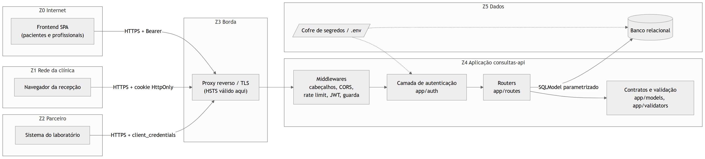

# Exercício 5 - Arquitetura de segurança e vetores de ataque

## Partições

| Zona | Componentes | Nível de confiança | Regra de travessia |
|---|---|---|---|
| Z0 Internet | Frontend SPA de pacientes e profissionais | Nenhum | Só entra com TLS, origem na allowlist de CORS e Bearer válido |
| Z1 Rede da clínica | Navegador da recepção | Baixo (máquinas compartilhadas) | Cookie HttpOnly restrito a `/web`, CSRF, sessão de 15 min |
| Z2 Parceiro | Sistema do laboratório | Contratual, limitado | client_credentials, `aud` exclusivo, escopo `horarios:ler` |
| Z3 Borda | Proxy reverso com TLS | Infraestrutura | Termina TLS, encaminha para Z4 (HSTS passa a valer) |
| Z4 Aplicação | Middlewares, `app/auth`, `app/routes`, `app/models` | Confiável após autenticação | Toda requisição passa pelo middleware JWT antes de qualquer rota |
| Z5 Dados | Banco relacional, cofre de segredos | Mais alta | Só a aplicação acessa; credencial vem do ambiente |

Dentro de Z4 há uma segunda partição, lógica: a camada `app/auth` é a única que decide identidade e permissão. As rotas só declaram o que exigem (`Security(obter_principal, scopes=[...])`, `Depends(consulta_legivel)`). Essa separação é o que permite auditar a autorização lendo um arquivo, e não espalhada por dezenas de handlers.

## Fluxo de dados entre partições

1. Z0/Z1/Z2 → Z3: requisição HTTPS.
2. Z3 → Z4: `CabecalhosDeSegurancaMiddleware` → `CORSMiddleware` → `SlowAPIMiddleware` → `AutenticacaoJWTMiddleware` → `GuardaAutorizacaoMiddleware` → rota. A ordem está em `main.py`: o middleware registrado por último é o mais externo, então cabeçalhos são aplicados até no 401 e no 429.
3. Z4 → Z5: SQLModel com parâmetros ligados; uma sessão por requisição.
4. Z5 → Z4 → Z0/Z1/Z2: o `response_model` de cada rota corta o registro conforme o consumidor.

## Vetores de ataque nos três eixos

| Eixo | Vetor | Partição | Ameaça | Resposta arquitetural |
|---|---|---|---|---|
| Design | Autorização só por papel, sem dono do objeto | Z4 | T-01, T-02, T-20 | RBAC + autorização por recurso (Exercício 6) |
| Design | Um único tipo de token para pessoa e parceiro | Z2/Z4 | T-04 | Audiência e tipo distintos, rota exclusiva do laboratório |
| Design | Recepção recebendo o mesmo contrato do profissional | Z1 | T-12 | Contrato `ConsultaAgenda` por consumidor |
| Design | Administrador só com senha | Z0 | T-08 | MFA obrigatório e claim `mfa` exigida nas rotas admin |
| Design | Falta de trilha de acesso | Z4/Z5 | T-15 | `RegistroAuditoria` |
| Implementação | SQL montado por concatenação | Z4/Z5 | T-09 | `select()` + whitelist |
| Implementação | Template com `|safe` | Z1 | T-10 | Autoescape, CSP |
| Implementação | Modelo aceitando campo extra | Z4 | T-11 | `extra="forbid"` |
| Implementação | Validação de JWT aceitando `alg` do cabeçalho ou sem `exp` | Z4 | T-06, T-07 | `algorithms=["HS256"]`, `require=[exp, iat, sub, iss, aud, jti]` |
| Implementação | Mensagem de login diferente para e-mail inexistente | Z4 | T-21 | Mensagem única, bcrypt contra hash fictício |
| Infraestrutura | Sem TLS / downgrade | Z3 | T-13 | HSTS; TLS no proxy (R-03) |
| Infraestrutura | CORS `*` | Z3/Z4 | T-14 | Allowlist no `.env`, wildcard recusado |
| Infraestrutura | Força bruta e flood | Z3/Z4 | T-05, T-16 | Rate limiting diferenciado |
| Infraestrutura | Segredo no repositório | Z5 | T-17 | `.env` fora do ZIP, `SecretStr`, Semgrep |
| Infraestrutura | Dependência vulnerável | Z4 | T-18 | pip-audit semanal |
| Infraestrutura | `/docs` público em produção | Z3 | T-22 | `CLINICA_DOCS_ATIVOS=false` |

## Consequência para o Exercício 6

A visão por partições definiu o modelo de autenticação: três populações com canais diferentes (Bearer para o frontend, cookie para a recepção, client_credentials para o parceiro) que convergem para um único ponto de validação de JWT, com a audiência separando o que é pessoa do que é sistema.
