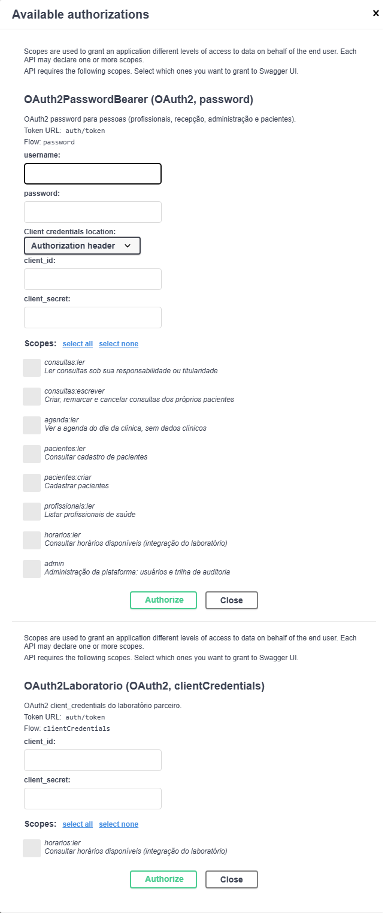
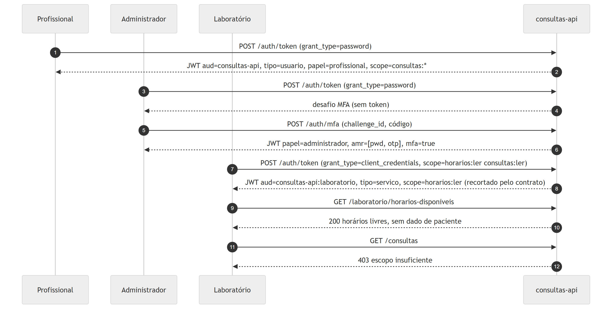

# Exercício 7 - Escopos e integração externa

## Fluxo escolhido: client_credentials

| Fluxo | Por que não serve ao laboratório |
|---|---|
| Authorization Code (+PKCE) | Pressupõe um usuário que autoriza no navegador; a integração é máquina a máquina |
| Password | Exigiria criar um usuário humano fictício e entregar a senha ao parceiro; mistura identidade de pessoa com sistema |
| Implicit | Descontinuado pelo OAuth 2.1; token na URL |
| Device Code | Para dispositivos sem teclado com usuário presente |
| **Client Credentials** | O cliente se autentica como ele mesmo, sem usuário. É o fluxo do RFC 6749, seção 4.4, para M2M |

O mesmo endpoint `POST /auth/token` atende os dois grants, como o RFC prevê. O segredo do laboratório fica no banco como hash bcrypt, falhas contam para o bloqueio por identidade e o esquema `OAuth2Laboratorio` (fluxo `clientCredentials`) é declarado no OpenAPI.

## Escopos garantidos tecnicamente

O contrato do laboratório está em `ClienteM2M.escopos_contratados = ["horarios:ler"]`. A garantia não depende do parceiro pedir certo:

1. **Recorte no emissor.** `recortar_escopos` concede a interseção entre o pedido e o contrato. Pedir `horarios:ler consultas:ler admin` resulta em token só com `horarios:ler`; pedir apenas escopos fora do contrato devolve 400.
2. **Audiência própria.** O token do parceiro tem `aud=consultas-api:laboratorio` e `tipo=servico`. `obter_principal` recusa a combinação de tipo e audiência que não bate, então nem um token de serviço com escopo de pessoa seria aceito.
3. **Rota exclusiva.** `exigir_laboratorio` exige `tipo=servico`; o token de uma profissional não serve em `/laboratorio/horarios-disponiveis`.
4. **Contrato de saída sem PII.** `HorarioDisponivel` só tem profissional, especialidade, início e fim. Mesmo que um token do laboratório seja comprometido, o pior que ele faz é ver a ocupação da agenda.
5. **Token curto e revogável.** Expira em 10 minutos; `ClienteM2M.ativo=false` invalida tokens já emitidos na requisição seguinte.

## Claims lado a lado

| Claim | Laboratório | Profissional |
|---|---|---|
| `aud` | `consultas-api:laboratorio` | `consultas-api` |
| `tipo` | `servico` | `usuario` |
| `sub` | `laboratorio-parceiro` | `3` |
| `cid` / `parceiro` | client_id e nome do laboratório | ausentes |
| `papel` | `parceiro` | `profissional` |
| `scope` | `horarios:ler` | `consultas:ler consultas:escrever pacientes:ler profissionais:ler` |
| `amr` / `mfa` | ausentes (não há pessoa) | `["pwd"]` / `false` |
| `exp - iat` | 600 s | 900 s |

## Evidências

`evidencias/ex07-m2m-escopos-claims.txt` mostra: segredo errado (401), recorte de escopo, pedido só fora do contrato (400), as claims comparadas, `GET /laboratorio/horarios-disponiveis` com 200 e o mesmo token recebendo 403 em `/consultas`, `/consultas/1` e `/pacientes/1`. Os testes `test_t04_*` cobrem os mesmos casos.
