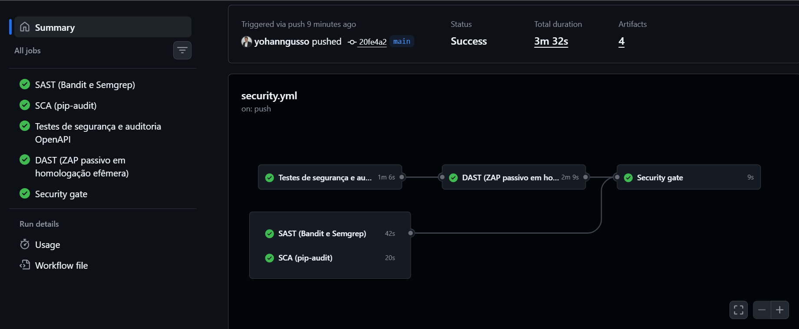

# Exercício 12 - Pipeline DevSecOps e auditoria automatizada

## Em que fase do SDLC cada tipo de ferramenta atua

| Tipo | Ferramenta | Fase | Gatilho | Por que nesta fase |
|---|---|---|---|---|
| SAST | Bandit e Semgrep (`p/python`, `p/owasp-top-ten`, `p/secrets`, `p/jwt`) | Codificação / commit e pull request | Todo push e PR | Não precisa da aplicação rodando, roda em segundos e aponta arquivo e linha. É onde aparecem SQL concatenado (V2) e credencial no código (V-10), que no histórico deste Assessment custaram caro. Achar aqui custa uma revisão; achar em produção custa um incidente com dado de saúde |
| SCA | pip-audit sobre `requirements.txt` | Build, no mesmo PR, e semanalmente (`schedule`) | Push, PR e cron de segunda | Vulnerabilidade de dependência surge sem nenhuma mudança no código: o mesmo `requirements.txt` aprovado ontem pode estar vulnerável hoje. Por isso o agendamento semanal |
| Testes de segurança | pytest (174 testes, um ou mais por ameaça T-xx) e auditoria OpenAPI | Build | Todo push e PR | Falhas de autorização (BOLA, BFLA) dependem do contexto de negócio e nenhum scanner as encontra; só teste escrito a partir do threat model as pega |
| DAST | OWASP ZAP baseline e API scan em modo seguro (passivo), autenticados | Teste / homologação efêmera, depois do build | Após os testes passarem | Precisa da aplicação no ar com a configuração real (middlewares, cabeçalhos, cookies). Passivo para poder rodar em todo PR sem alterar dados nem derrubar o ambiente |
| IAST | Agente instrumentando a aplicação (ex.: Contrast) | QA / testes de integração, junto com os testes funcionais | Ambiente de QA | Correlaciona a requisição do teste com a linha executada, reduzindo falso positivo do DAST. Não foi implementado: não há agente IAST gratuito para Python/FastAPI. Registrado como lacuna (R-08); a suíte pytest com `TestClient` cobre parcialmente o papel ao exercitar o código real por dentro |

A ordem no workflow segue o custo: o que é barato e determinístico (SAST, SCA, testes) roda primeiro e em paralelo; o DAST só roda se os testes passarem; o gate só decide depois de todas as evidências.

## Priorização das vulnerabilidades: CVSS 3.1 e impacto de negócio

Scores calculados com a biblioteca `cvss` (`AT_ferramentas/calcular_cvss.py`, saída em `evidencias/ex12-cvss.md`).

| ID | Vulnerabilidade | Vetor CVSS 3.1 | Score | Impacto de negócio | Prioridade |
|---|---|---|---|---|---|
| V-10 | Contas de avaliação com hash no código | `AV:N/AC:L/PR:N/UI:N/S:U/C:H/I:H/A:N` | 9.1 Crítica | Se ligado em produção, credenciais publicadas no README dão acesso total a dados de saúde | P0 |
| V-07 | Administrador sem segundo fator | `AV:N/AC:H/PR:N/UI:N/S:U/C:H/I:H/A:H` | 8.1 Alta | Uma senha vazada entrega usuários, trilha de auditoria e toda a base | P0 |
| V-03 | SQL injection na busca | `AV:N/AC:L/PR:L/UI:N/S:U/C:H/I:L/A:L` | 7.6 Alta | Extração em massa de CPFs e hashes; incidente comunicável à ANPD | P0 |
| V-04 | XSS armazenado na agenda | `AV:N/AC:L/PR:L/UI:R/S:C/C:H/I:L/A:N` | 7.6 Alta | Uma observação maliciosa atinge a recepção de toda a clínica | P0 |
| V-06 | Login sem limite, sem bloqueio, com enumeração | `AV:N/AC:H/PR:N/UI:N/S:U/C:H/I:H/A:N` | 7.4 Alta | Tomada de conta; já ocorreram tentativas de força bruta | P0 |
| V-01 | BOLA em consultas | `AV:N/AC:L/PR:L/UI:N/S:U/C:H/I:N/A:N` | 6.5 Média | Dado de saúde de terceiros a partir de qualquer conta de paciente; dano reputacional e sanção (LGPD art. 52) | P0 (ver critério) |
| V-05 | Mass assignment | `AV:N/AC:L/PR:L/UI:N/S:U/C:N/I:H/A:N` | 6.5 Média | Consulta em nome de outro profissional e trilha falsificada | P1 |
| V-09 | CORS com wildcard | `AV:N/AC:H/PR:N/UI:R/S:U/C:H/I:N/A:N` | 5.3 Média | Reprovação em auditoria de pré-produção | P1 |
| V-02 | BOLA em pacientes | `AV:N/AC:L/PR:L/UI:N/S:U/C:L/I:N/A:N` | 4.3 Média | Cadastro de paciente alheio (CPF já mascarado) | P1 |
| V-11 | Formulários sem token anti-CSRF | `AV:N/AC:L/PR:N/UI:R/S:U/C:N/I:L/A:N` | 4.3 Média | Login/logout forçado da recepção | P1 |
| V-12 | Erro 422 refletindo o valor enviado | `AV:N/AC:L/PR:L/UI:N/S:U/C:L/I:N/A:N` | 4.3 Média | Dado sensível reaparecendo em log de erro do cliente | P2 |
| V-08 | Sem cabeçalhos de segurança | `AV:N/AC:H/PR:N/UI:R/S:U/C:L/I:L/A:N` | 4.2 Média | Clickjacking, sniffing; item de checklist de auditoria | P1 |
| V-13 | Sem COOP/CORP/COEP/Permissions-Policy | `AV:N/AC:H/PR:N/UI:R/S:U/C:L/I:N/A:N` | 3.1 Baixa | Endurecimento adicional | P2 |

O CVSS base não enxerga o domínio. A BOLA do enunciado sai com 6.5 porque a fórmula não sabe que o dado exposto é de saúde nem que a exploração é trivial e em massa. O critério de impacto de negócio sobe a prioridade dela para P0.

## Critério de severidade do security gate

`ci/security_gate.py` lê os relatórios de Bandit, Semgrep, pip-audit e ZAP e **bloqueia** o pipeline quando houver:

1. qualquer achado de severidade alta ou crítica (equivalente a CVSS ≥ 7.0);
2. achado médio cuja CWE pertença às classes que, neste Assessment, produziram as vulnerabilidades mais graves: controle de acesso (A01: CWE-22, 200, 201, 284, 285, 352, 359, 425, 639, 862, 863), injeção (A03: CWE-78, 79, 89, 94, 943) e credencial no código (CWE-259, 798);
3. qualquer vulnerabilidade conhecida em dependência (o pip-audit não informa severidade; na dúvida, conta como alta);
4. relatório ausente (fail-closed: etapa que não produziu evidência conta como reprovada).

Achados abaixo disso viram aviso no resumo do job. Exceções exigem ferramenta, regra, **arquivo**, justificativa, aprovador e **data de validade** em `ci/excecoes-seguranca.json`; vencida a data, o achado volta a bloquear.

Justificativa:

- Só CVSS ≥ 7.0 deixaria passar a BOLA (6.5), que é a falha mais grave do histórico e o motivo do Exercício 8. A regra 2 corrige exatamente isso usando a CWE, que é estável entre ferramentas.
- A severidade das ferramentas é genérica: o Bandit classifica SQL concatenado como médio (B608) e o ZAP classifica ausência de token CSRF como médio. Nos dois casos, o impacto aqui é alto.
- Bloquear todo médio pararia o time por achados de baixo impacto (cabeçalhos opcionais, informativos do ZAP), e um gate que bloqueia sempre acaba desligado. O critério bloqueia o que já causou dano e avisa o resto.
- Exceção com arquivo e prazo evita o "aceite permanente": a exceção do SQL de demonstração vale para `app/routes/inseguro.py` e não para um SQL concatenado novo em outro arquivo.

## Execução do gate

| Rodada | Entrada | Resultado | Evidência |
|---|---|---|---|
| 1 | Bandit + Semgrep + pip-audit, código como estava | **BLOQUEADO**: 7 hashes de contas de avaliação em `app/database.py` (Semgrep, CWE-798) e o SQL concatenado de demonstração (Semgrep e Bandit, CWE-89) | `evidencias/pipeline/gate-rodada1.md` |
| Correção | Contas de avaliação movidas para `app/seed.py`, desligadas por padrão (`CLINICA_CARREGAR_DADOS_DEMONSTRACAO=false`); exceções com prazo para o seed e para o router de demonstração | | `ci/excecoes-seguranca.json` |
| 2 | Mesmas ferramentas | APROVADO com 3 exceções e 2 avisos de baixa severidade | `evidencias/pipeline/gate-rodada2.md` |
| ZAP rodada 1 | Relatórios do ZAP | **BLOQUEADO**: ausência de token anti-CSRF (médio, CWE-352, A01) | `evidencias/zap/rodada1/gate-zap-rodada1.md` |
| 3 | Todas as ferramentas e ZAP rodada 2, já com o workflow e o CSRF escritos | **BLOQUEADO**: saída do `curl` canalizada para o `python` no job de DAST (Semgrep `gha-curl-pipe-shell`, CWE-78) e `bool()` sobre o token CSRF recebido (Semgrep `nan-injection`) | `evidencias/pipeline/gate-rodada3.md` |
| Correção | Resposta do `curl` gravada em arquivo antes de ser lida; `csrf_valido` reescrito sem o cast | | |
| Final | Todas as ferramentas | APROVADO | `evidencias/pipeline/gate-final.md` |

## Workflow GitHub Actions

`.github/workflows/security.yml`:

| Job | Depende de | O que faz |
|---|---|---|
| `sast` | | Bandit e Semgrep, relatórios em JSON como artefato |
| `sca` | | pip-audit em JSON |
| `testes` | | `pip install -r requirements-dev.txt`, pytest com JUnit, `ci/auditar_openapi.py` (falha se houver achado ALTA) |
| `dast` | `testes` | Sobe a aplicação com segredo gerado na hora, autentica profissional e recepção com credenciais vindas de `secrets`, roda ZAP baseline e API scan passivos com `.zap/rules.tsv` |
| `security-gate` | todos | Falha se alguma etapa não concluiu; aplica `ci/security_gate.py` sobre os artefatos e publica o resumo em `GITHUB_STEP_SUMMARY` |

As ferramentas rodam com `|| true` para sempre produzir relatório; quem decide é o gate, em um lugar só. Permissões do token do workflow restritas a `contents: read`. Segredos de homologação mascarados com `::add-mask::`.

Quando o próprio workflow passou pelo Semgrep, ele apontou actions referenciadas por tag mutável (`@v4`, CWE-1357): o dono da action pode reapontar a tag e injetar código no pipeline. Como é médio fora das classes bloqueantes, entrou como aviso; ainda assim foi corrigido fixando cada action pelo SHA do commit (com a versão em comentário) e as imagens do Semgrep e do ZAP por digest.

A mesma sequência também roda localmente (`AT_ferramentas/executar_pipeline_local.py`), com Semgrep e ZAP pelas imagens Docker oficiais. As saídas estão em `evidencias/pipeline/` e `evidencias/zap/`.

## Execução no GitHub Actions

O projeto está no repositório privado `yohanngusso/consultas-api-dr2-at`. Os quatro segredos do DAST foram cadastrados como Actions secrets (cifrados com a chave pública do repositório) e aparecem como `***` nos logs. Resumo e log de cada job estão em `evidencias/github-actions/`.

| Execução | Evento | Resultado | O que demonstra |
|---|---|---|---|
| 37166298281 | push na `main` (commit inicial) | Todos os jobs verdes em 3m32s; gate APROVADO com 18 achados, 0 bloqueantes e 3 exceções | Pipeline completo rodando no GitHub com o mesmo resultado da execução local: 174 testes, OpenAPI sem achados, ZAP autenticado sem falhas |
| 37166685255 | push na `main` (Dependabot) | Verde | `.github/dependabot.yml` passa a abrir PRs semanais para pip e para as actions fixadas por SHA; cada PR do Dependabot passa pelo mesmo pipeline |
| 37166747797 | pull request #1 | Testes, SAST, SCA e DAST verdes; **gate BLOQUEADO** | PR de demonstração com `buscar_paciente_por_cpf` montando SQL por f-string em `app/database.py`. Os testes passam porque a função não é usada; quem barra é o gate: Semgrep `avoid-sqlalchemy-text` (alta) e Bandit B608 (médio, mas CWE-89). A exceção de `app/routes/inseguro.py` não cobre o arquivo novo. PR fechado sem merge |

O PR #1 mostra o motivo de o gate ser um job separado: um pipeline que só rodasse testes teria aprovado a mudança.

Limitação: tornar o `Security gate` um status check obrigatório para merge na `main` (branch protection ou rulesets) exige GitHub Pro em repositório privado. No plano gratuito o bloqueio aparece no PR, mas não impede tecnicamente o merge (risco residual R-10).

## Testes de autorização expandidos a partir do threat model

`tests/test_autorizacao.py` começou com o teste de rota administrativa do Exercício 6 (T-03) e foi expandido para os vetores do threat model. Cada teste carrega o ID da ameaça no nome:

| Ameaça | Vetor coberto |
|---|---|
| T-01 | Paciente lendo consulta de outro; profissional lendo consulta de outro; enumeração sequencial; 404 antes de 403; rotas sem token |
| T-02 | Profissional lendo paciente de outro; busca restrita; agendamento para paciente alheio |
| T-03 | Três papéis contra duas rotas admin; administrador com MFA; pedido de escopo `admin` por profissional |
| T-04 | Token do laboratório em cinco rotas de dados; escopo fora do contrato; claims sem PII; usuário na rota do laboratório |
| T-06 | `alg=none`; assinatura com outra chave; payload adulterado; papel divergente do cadastro |
| T-07 | Token expirado; sem `exp`; audiência trocada; usuário desativado com token válido |
| T-08 | Senha do admin sem token; código MFA errado; token de admin sem claim `mfa` |
| T-11 | Quatro campos de mass assignment |
| T-15 | Acesso negado registrado na trilha |
| T-19 | Agenda sem sessão; profissional na página da recepção |
| T-20 | Paciente alterando/cancelando; profissional alterando consulta alheia |

Os vetores de entrada e de infraestrutura (T-05, T-09, T-10, T-13, T-14, T-17, T-19, T-21, T-22) estão em `tests/test_entrada.py` e `tests/test_cabecalhos_e_limites.py`. Saída completa: `evidencias/ex12-ex13-suite-pytest.txt`.
