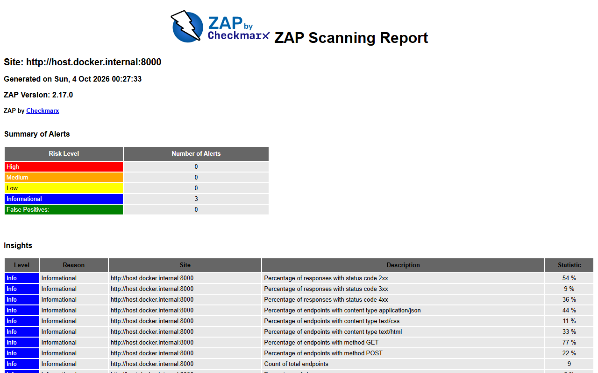

# Exercício 13 - Capstone: auditoria final

## Aplicação final

| Camada | Controle | Onde |
|---|---|---|
| Autenticação | OAuth2 password e client_credentials, bcrypt, JWT com `exp`/`aud`, MFA, bloqueio por identidade, CSRF na página | `app/auth/`, `app/routes/auth.py`, `app/routes/web.py` |
| Autorização | Middleware JWT fail-closed, RBAC por escopo, `exigir_posse`, guarda de posse, trilha de auditoria | `app/middlewares.py`, `app/auth/dependencies.py` |
| Validação | `extra="forbid"`, regex, enums, janelas de data, erro 422 sem eco | `app/models.py`, `app/validators.py`, `main.py` |
| Saída | `response_model` por consumidor, CPF mascarado, autoescape | `app/models.py`, `templates/` |
| Cabeçalhos e rede | HSTS, XFO, XCTO, CSP, COOP/CORP/COEP, Permissions-Policy, `no-store`, CORS allowlist, rate limiting | `app/middlewares.py`, `main.py`, `app/limiter.py` |
| Persistência | SQLModel parametrizado, sessão por dependência, `BaseSettings` + `.env` | `app/database.py`, `app/config.py` |

## Scan passivo com OWASP ZAP

Executado com a imagem oficial `zaproxy/zap-stable` (Docker), contra a aplicação rodando com a configuração de entrega (sem o router de demonstração), autenticado:

- `zap-baseline.py -t /web/agenda -m 2`: spider de 2 minutos e regras passivas na página da recepção, com o cookie de sessão de uma recepcionista injetado por `ZAP_AUTH_HEADER`.
- `zap-api-scan.py -t /openapi.json -f openapi -S`: importa as 20 operações do OpenAPI; `-S` (safe mode) desliga o scan ativo e faz só a análise passiva. Autenticado com o Bearer de uma profissional.

Na primeira tentativa o cabeçalho de autorização foi passado por `-z replacer...` e o valor "Bearer <token>" foi quebrado no espaço: todas as 19 rotas protegidas responderam 401 e o scan só viu respostas de erro. A rodada válida usa as variáveis `ZAP_AUTH_HEADER`/`ZAP_AUTH_HEADER_VALUE` do próprio ZAP, e o log do servidor confirmou 200/403/404/422 nas rotas protegidas.

### Rodada 1 (antes)

| Plugin | Alerta | Risco | CWE | Onde |
|---|---|---|---|---|
| 10202 | Absence of Anti-CSRF Tokens | Médio | 352 | `/web/login`, `/web/agenda` (formulários de login e logout) |
| 90004 | Cross-Origin-Embedder-Policy / Opener-Policy / Resource-Policy ausentes | Baixo | 693 | Páginas e API |
| 10063 | Permissions Policy Header Not Set | Baixo | 693 | Páginas |
| 10096 | Timestamp Disclosure - Unix | Baixo | 497 | `/auth/eu` |
| 10049 | Non-Storable / Storable Content | Informativo | 524 | Geral |
| 100000 | Client Error response | Informativo | 388 | Rotas protegidas (403/404/422 esperados) |

O gate bloqueou a rodada 1 pela ausência de token anti-CSRF (médio com CWE de A01). Relatórios em `evidencias/zap/rodada1/`.

### Correções

| Alerta | Correção |
|---|---|
| 10202 CSRF | `app/auth/csrf.py`: token aleatório em cookie HttpOnly/SameSite=Strict e campo oculto `csrf_token`, comparados com `compare_digest` no login e no logout. Novo token após o login |
| 90004, 10063 | `Cross-Origin-Opener-Policy: same-origin`, `Cross-Origin-Resource-Policy: same-origin`, `Cross-Origin-Embedder-Policy: require-corp` (fora da documentação) e `Permissions-Policy` restritiva em `CABECALHOS_DE_SEGURANCA` |
| 10029 Cookie Poisoning (apareceu na primeira execução da rodada 2) | A resposta do POST regravava o cookie CSRF com o mesmo valor do campo enviado; `garantir_cookie_csrf` só grava quando o cookie ainda não existe |
| 10096 | Falso positivo: `iat`/`exp` do próprio token devolvidos ao titular. Registrado como `IGNORE` justificado em `.zap/rules.tsv` |
| 10049, 100000 | Informativos esperados: `no-store` é intencional e os 4xx são os controles funcionando. `IGNORE` justificado |

Também foi adicionado `--no-server-header` na execução do uvicorn.

### Rodada 2 (depois)

Nenhum alerta médio ou alto; restaram apenas os informativos e o falso positivo justificado. Gate aprovado. Relatórios em `evidencias/zap/rodada2/`.

## Testes unitários com mocking

`tests/test_unitarios_mock.py` (50 testes) isola regras de entrada e de autorização do banco, da rede e do relógio:

| Alvo | Técnica | O que prova |
|---|---|---|
| `pode_ler_consulta`, `pode_alterar_consulta`, `pode_ler_paciente` | Principais e objetos falsos (`SimpleNamespace`) | Matriz de posse por papel, inclusive papel desconhecido |
| `exigir_posse` | `MagicMock` no carregador e `patch` em `registrar_auditoria` | 403 + auditoria "negado" + requisição não marcada; 404 para id malformado ou inexistente sem chamar a regra |
| `obter_principal` | `patch` em `obter_usuario_por_id` | Usuário desativado → 401; sem claims → 401; escopo ausente → 403 auditado |
| `GuardaAutorizacaoMiddleware` | App mínimo com rota sem verificação | Rota que esquece a posse responde 500 sem vazar o corpo |
| `autenticar_usuario` | `patch` no repositório e no bcrypt | E-mail inexistente ainda executa o bcrypt (tempo constante); bloqueio após 5 falhas mesmo com senha correta |
| Desafio MFA | `patch` em `time.monotonic` | Expira em 5 min; descartado após 3 erros; uso único |
| Validadores | Relógio fixo com `patch` em `agora_na_clinica` | Whitelist da busca, CPF, máscara, horário de atendimento |

## Auditoria da especificação OpenAPI

`ci/auditar_openapi.py` lê `app.openapi()` e verifica:

1. toda operação não pública declara requisito de segurança;
2. nenhum schema de resposta 2xx contém campo interno (`token_auditoria`, `criado_por_id`, `ip_origem`, `senha_hash`, `segredo_hash`, `cpf`...), percorrendo `$ref`, `items` e `anyOf`;
3. corpo JSON com `additionalProperties: false` (`extra="forbid"`);
4. strings de parâmetros e corpos com `maxLength`, `pattern`, `enum` ou formato fechado;
5. rotas protegidas documentam 401, 403 e 429;
6. os dois fluxos aceitos pelo `/auth/token` estão declarados em `securitySchemes`.

| Execução | Achados | Evidência |
|---|---|---|
| Primeira | 15: fluxo `clientCredentials` não declarado; 14 operações sem 401/403/429 documentados | `evidencias/openapi/auditoria-antes.md` |
| Após correção (`OAuth2Laboratorio` e `RESPOSTAS_DE_ERRO` nos routers) | 0 | `evidencias/openapi/auditoria-depois.md` |
| Com o router de demonstração ligado | 12, sendo 2 ALTA (rotas sem segurança): o script sai com erro | `evidencias/openapi/auditoria-modo-vulneravel.md` |

O script roda no job `testes` do pipeline e falha em achado ALTA. Em produção a especificação inteira pode ser desligada com `CLINICA_DOCS_ATIVOS=false`.

## Relatório final

A correlação ameaça → OWASP → finding → correção → evidência e os riscos residuais estão em [relatorio-rastreabilidade.md](relatorio-rastreabilidade.md).
